<p align="center">
  
</p>

# Foxcrypto — Flutter Crypto App

A pixel-faithful crypto trading app built in Flutter from the **"Foxcrypto – Crypto App (Community)"** Figma design. Onboarding, authentication, KYC verification and a live market dashboard — recreated screen by screen with the design's dark theme and brand-yellow accents.

<p align="center">
  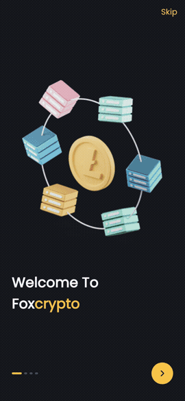
</p>

<p align="center"><em>Onboarding → Sign up → Verify account → Home → Market → Quick actions</em></p>

## Features

- **Onboarding** — 4 slides with Skip / Next and animated page dots
- **Auth** — log in and sign up with full field validation
- **Email verification** — custom number pad with a resend timer
- **KYC / Verify account** — country + document type picker, ID photo upload and selfie upload
- **Verified** — success screen that flows into the app
- **Home dashboard** — balance card, top coins with animated sparklines, and a news feed
- **Market** — tabbed market view of live coin cards
- **Quick actions** — centre FAB opens a Buy / Sell / Send / Receive sheet
- **Bottom navigation** — Home · Market · Portfolio · Settings

## Screenshots

| Onboarding | Security | Trading | Log In |
|:---:|:---:|:---:|:---:|
|  | 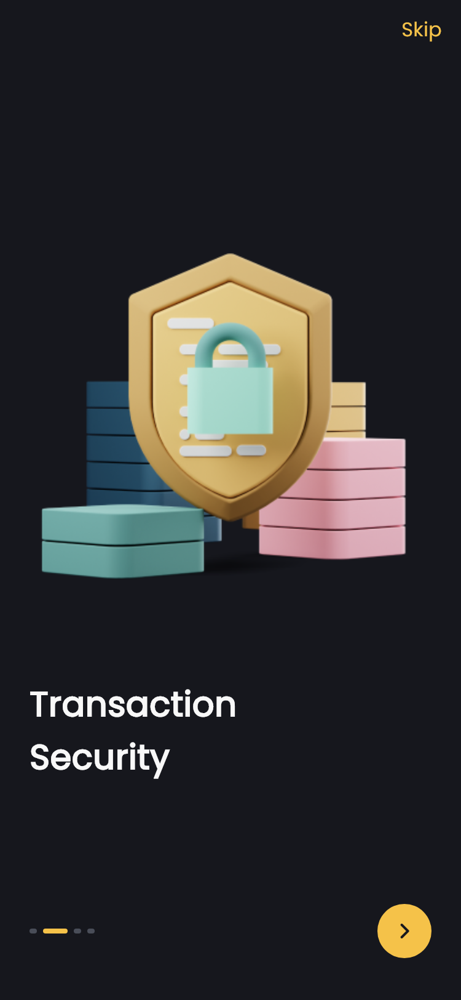 |  | 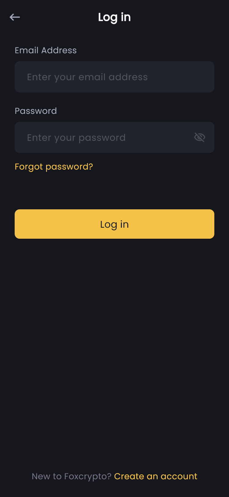 |

| Sign Up | Email Verification | Verify Document | Verify ID |
|:---:|:---:|:---:|:---:|
| 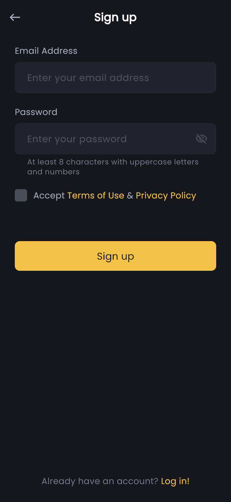 | 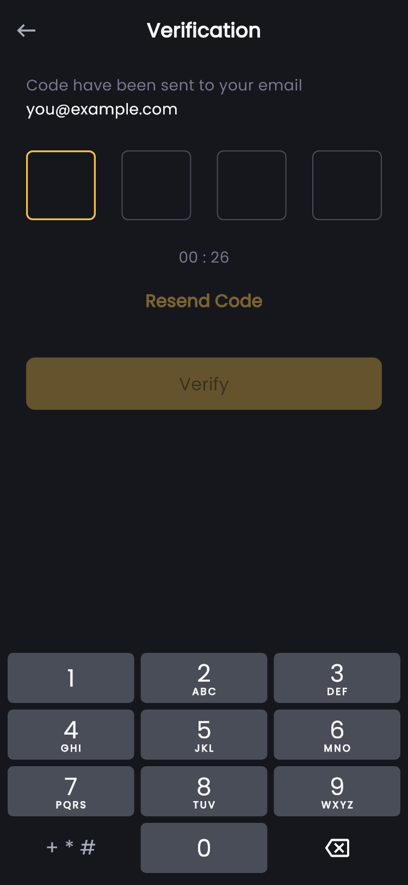 | 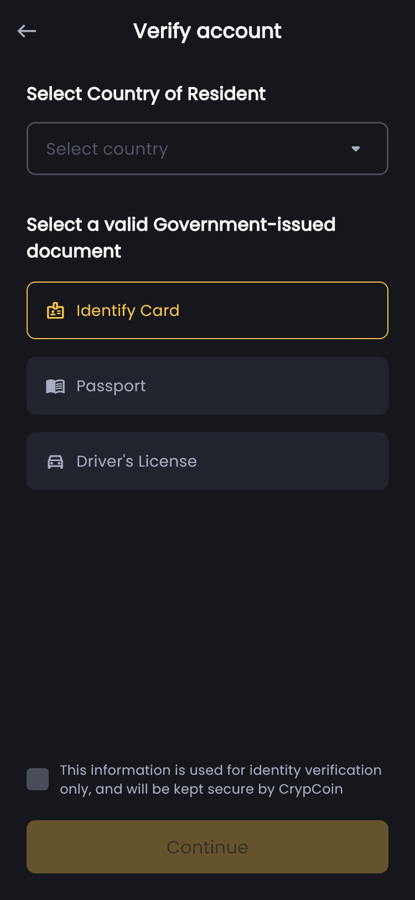 | 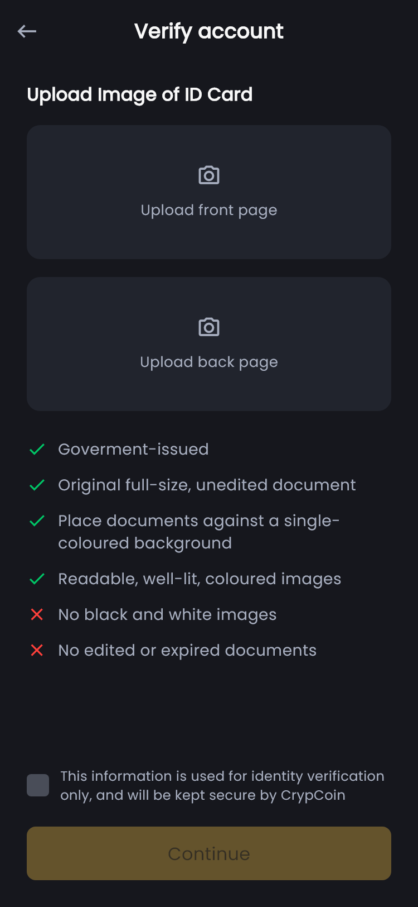 |

| Verify Selfie | Verified | Home | Market |
|:---:|:---:|:---:|:---:|
| 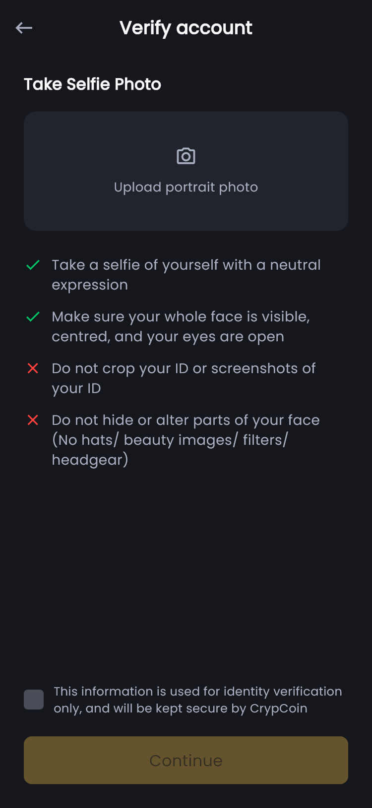 | 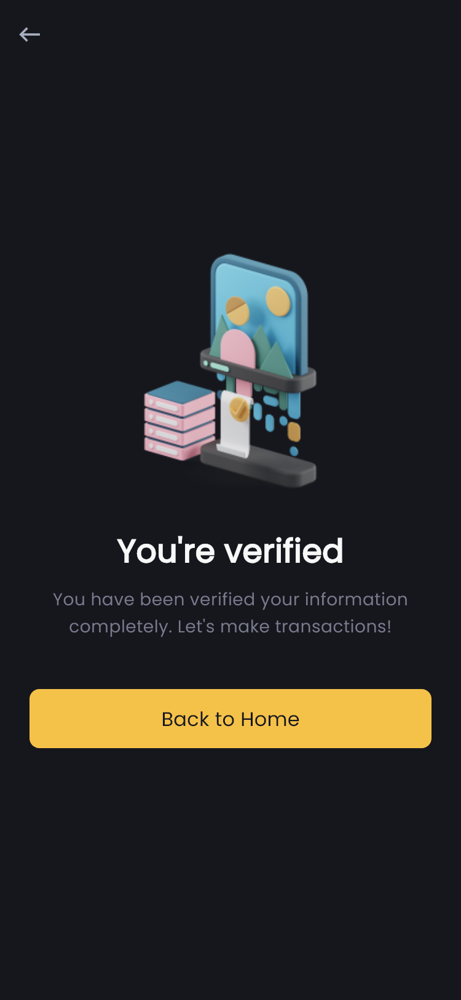 | 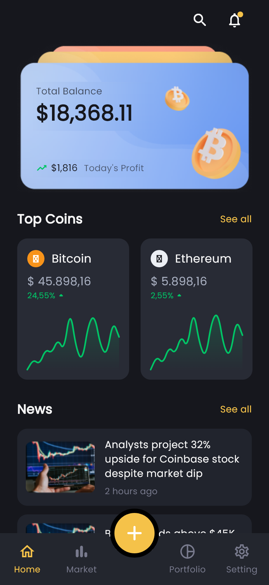 | 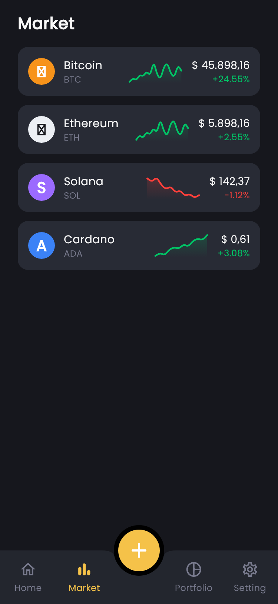 |

| Quick Actions | Portfolio | Settings |
|:---:|:---:|:---:|
| 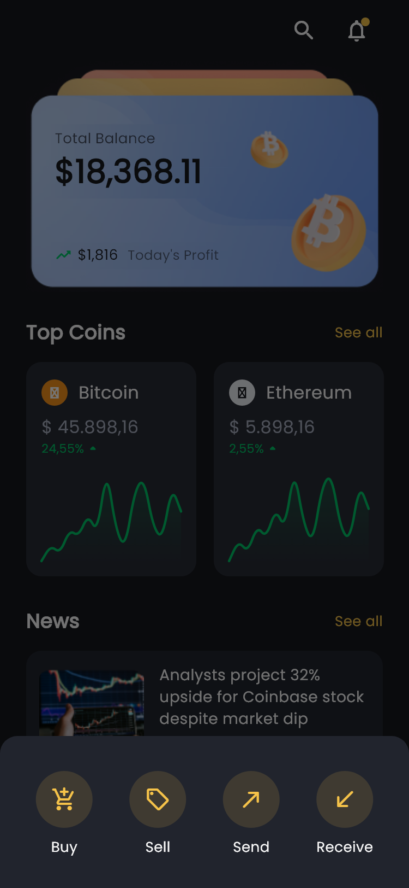 | 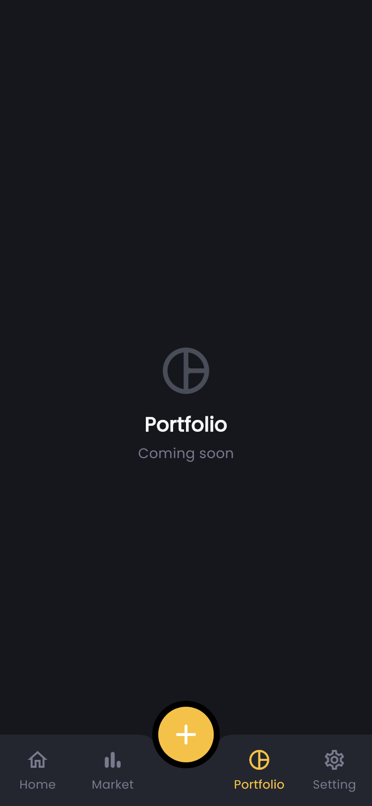 |  |

## Flow

```
Onboarding (Skip / Next) → Sign up ─┐
                 Log in ────────────┴→ Home
                                     │
Sign up → Email code verification → Verify account
          (country + document, ID, selfie) → You're verified → Home

Home tabs: Home · Market · Portfolio · Settings
FAB (+):   Buy · Sell · Send · Receive
```

## Getting started

Requires the [Flutter SDK](https://docs.flutter.dev/get-started/install).

```bash
flutter pub get
flutter run
```

## Project structure

```
lib/
  main.dart              – app entry & theme wiring
  theme.dart             – colours + Poppins text theme from the Figma style guide
  widgets/
    common.dart          – buttons, inputs, header, checkbox, upload card
  screens/
    onboarding_screen.dart  – 4-slide onboarding
    auth_screens.dart       – login, sign up, email code verification
    verify_screens.dart     – verify document / ID / selfie, verified
    home_screen.dart        – dashboard, market, balance card, sparklines, news
assets/
  images/                – illustrations exported from the design
  fonts/                 – Poppins (used by GoogleFonts offline)
docs/screenshots/        – README screenshots
media/                   – demo video & GIF
```

## Regenerating the screenshots

`test_screens/shots_test.dart` renders every screen to PNG — with the bundled
Poppins fonts — so the app can be compared side by side against the Figma design:

```bash
flutter test test_screens --update-goldens
# output: test_screens/out/*.png  (copied into docs/screenshots/)
```

## Notes

Coin prices and news are sample data in `lib/screens/home_screen.dart`; swap them for a real market API when ready.

## Credits

Design based on the **Foxcrypto – Crypto App (Community)** [Figma](https://www.figma.com/community) template.
Flutter implementation and demo assets by [TanimowoObaloluwaDavid](https://github.com/TanimowoObaloluwaDavid).
